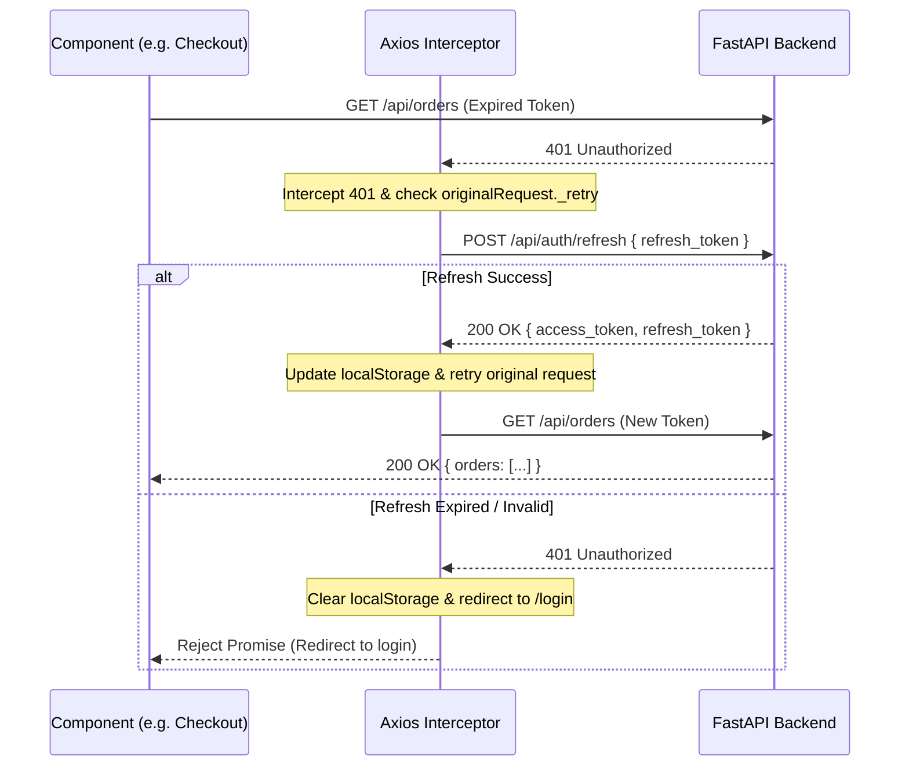

# Elaanji E-Commerce — Comprehensive Error Code Documentation

This document provides a complete reference for all HTTP status codes, application error codes, meanings, root causes, and recommended resolutions across the Elaanji platform (Backend API, Database, Payment Gateway, and Frontend/Client integrations).

---

## 1. Standard Error Response Format

All backend API error responses conform to a unified JSON structure managed by `app.core.exceptions.register_exception_handlers`:

```json
{
  "detail": "Human-readable description of the error",
  "error": {
    "code": "ERROR_CODE_STRING",
    "message": "Human-readable description of the error",
    "details": null,
    "status_code": 400,
    "timestamp": "2026-09-08T17:42:00.000Z",
    "request_id": "req-9b8c12a4-5678"
  }
}
```

* **`detail`** *(string)*: Standard FastAPI string for backward compatibility with Axios `error.response?.data?.detail`.
* **`error.code`** *(string)*: Machine-readable uppercase identifier for client-side programmatic branching.
* **`error.details`** *(any | null)*: Optional contextual metadata (e.g., validation field list, remaining inventory numbers).
* **`error.status_code`** *(integer)*: Standard RFC HTTP status code.
* **`error.timestamp`** *(string)*: ISO-8601 UTC timestamp of the error event.
* **`error.request_id`** *(string | null)*: Unique request tracing ID for backend log correlation.

---

## 2. HTTP Status Code Taxonomy

| HTTP Status | Category | Meaning | Elaanji Usage |
| :--- | :--- | :--- | :--- |
| **`200 OK`** | Success | Request succeeded | Standard reads and successful operations |
| **`201 Created`** | Success | Resource created | Registrations, address creation, orders placed |
| **`400 Bad Request`** | Client Error | Business logic violation or illegal state | Empty carts, invalid coupons, zero-quantity rules |
| **`401 Unauthorized`** | Client Error | Missing or invalid authentication token | Expired JWT, bad credentials, missing Bearer token |
| **`403 Forbidden`** | Client Error | Authenticated user lacks permission | Regular customer trying to access `/api/admin/*` |
| **`404 Not Found`** | Client Error | Resource does not exist | Invalid product slug, missing address ID, missing order |
| **`409 Conflict`** | Client Error | Duplicate entry or state collision | Email already registered, item out of stock at checkout |
| **`422 Unprocessable Entity`**| Client Error | Schema/validation failure | Missing required fields, invalid phone number, bad email format |
| **`429 Too Many Requests`** | Client Error | Rate limit exceeded | Excessive password attempts, rapid API polling |
| **`500 Internal Server Error`**| Server Error | Unhandled server exception | Database disconnection, runtime unhandled crash |
| **`502 Bad Gateway`** | Server Error | External third-party failure | Razorpay API unreachable, Cloudinary failure |

---

## 3. Core Application Error Codes (`error.code`)

| Error Code | HTTP Status | Description & Meaning |
| :--- | :---: | :--- |
| `VALIDATION_ERROR` | **422** | Pydantic schema validation failed (e.g. invalid type, missing field). |
| `BAD_REQUEST` | **400** | General invalid operation requested by the client. |
| `UNAUTHORIZED` | **401** | Missing or expired JWT access/refresh token. |
| `FORBIDDEN` | **403** | Insufficient permissions (e.g., non-admin requesting admin routes). |
| `NOT_FOUND` | **404** | Requested record does not exist or was soft-deleted. |
| `CONFLICT` | **409** | Duplicate unique identifier (SKU, slug, email) or concurrent mutation. |
| `INSUFFICIENT_STOCK`| **409** | Requested quantity exceeds available live inventory. |
| `PAYMENT_GATEWAY_ERROR`| **502** | External payment provider (Razorpay) failed to respond or verify. |
| `RATE_LIMITED` | **429** | Too many requests within the rate limit window. |
| `INTERNAL_SERVER_ERROR`| **500** | Uncaught application exception or database outage. |

---

## 4. Module-Specific Error Codes & Scenarios

### 4.1. Authentication & Accounts (`/api/auth`)

| Status | Message / Detail | Cause | Recommended Client Action |
| :---: | :--- | :--- | :--- |
| **401** | `Incorrect email or password` | Bad login credentials. | Show "Incorrect email or password" error toast. |
| **401** | `Invalid or expired refresh token` | Refresh token expired or revoked. | Clear localStorage tokens and redirect to `/login`. |
| **401** | `Refresh token required` | No token provided in refresh request. | Re-prompt user to log in. |
| **401** | `User not found or inactive` | User record deleted or suspended. | Invalidate session; prompt user to contact support. |
| **401** | `Could not validate credentials` | JWT expired, altered, or corrupt. | Trigger silent token refresh via `/auth/refresh`. |
| **401** | `Invalid Google token` | Google ID token verification failed. | Prompt user to retry Google One Tap / Sign-In. |
| **403** | `Account is disabled` | User `is_active = False`. | Display "Your account has been deactivated. Please contact support." |
| **403** | `Admin privileges required` | Non-admin accessing admin routes. | Redirect user away to customer storefront home. |
| **409** | `Email is already registered` | Registration with existing email. | Suggest signing in or password recovery. |
| **409** | `Phone number is already registered`| Registration with duplicate phone. | Prompt user to log in or use another number. |
| **400** | `Current password is incorrect` | Password change endpoint mismatch. | Advise user to re-enter current password. |
| **400** | `Reset token is invalid or expired` | Password reset link expired. | Ask user to request a new password reset link. |

---

### 4.2. Shopping Cart & Wishlist (`/api/cart`, `/api/wishlist`)

| Status | Message / Detail | Cause | Recommended Client Action |
| :---: | :--- | :--- | :--- |
| **404** | `This item is not available` | Product or variant is deactivated. | Remove item from cart and notify user. |
| **404** | `Cart item not found` | Attempted update/delete on non-existent cart item. | Refetch cart using `useCart()`. |
| **404** | `Product not found` | Invalid product ID added to wishlist. | Show toast: "Product unavailable". |
| **400** | `Requested quantity exceeds available stock (max {n})` | User selected more than in stock. | Cap quantity selector to `{n}` and display warning. |
| **400** | `Quantity must be at least 1` | Updating cart quantity to 0. | Use item deletion instead of quantity 0. |

---

### 4.3. Orders & Checkout (`/api/orders`, `/api/checkout`)

| Status | Message / Detail | Cause | Recommended Client Action |
| :---: | :--- | :--- | :--- |
| **400** | `Your cart is empty` | Triggered place order on empty cart. | Redirect customer to `/cart` or `/shop`. |
| **404** | `Address not found` | Selected `address_id` does not exist or belong to user. | Re-fetch address list; prompt to re-select address. |
| **409** | `An item in your cart is no longer available` | Product was deleted between cart and checkout. | Refresh cart and display updated item availability. |
| **409** | `Insufficient stock for "{name}" ({n} remaining)` | Flash sale / race condition depleted stock. | Reduce quantity in cart to `{n}` and prompt to retry. |
| **400** | `Invalid coupon code` | Code not found in database. | Show coupon error: "Code not recognized". |
| **400** | `Coupon requires a minimum order of ₹{min}` | Cart subtotal below coupon requirement. | Prompt user to add items to meet threshold. |
| **400** | `Coupon has expired` | Past coupon `valid_until` date. | Show "Coupon expired" and clear coupon input. |
| **400** | `Coupon usage limit reached` | Total allowed redemptions exceeded. | Clear discount and advise coupon is exhausted. |
| **400** | `Order cannot be cancelled in status '{status}'` | Customer cancelling shipped/delivered order. | Inform user: "Order has already shipped; please initiate a return." |

---

### 4.4. Payments & Razorpay (`/api/payments`)

| Status | Message / Detail | Cause | Recommended Client Action |
| :---: | :--- | :--- | :--- |
| **400** | `This order is not awaiting payment` | Attempting to pay for an already paid or cancelled order. | Navigate customer to the Order Detail page. |
| **400** | `Payment record mismatch` | Razorpay order ID does not match database record. | Prevent order completion; log incident. |
| **400** | `Invalid payment signature` | Cryptographic signature verification failed. | Mark payment pending; prompt user to retry payment. |
| **404** | `Order not found` | Unknown order ID passed to payment creation. | Redirect to `/orders`. |
| **502** | `Razorpay payment gateway error` | Razorpay API unreachable or key misconfigured. | Display: "Payment gateway busy. Please retry in a moment." |

---

### 4.5. Products, Categories & Inventory (`/api/products`, `/api/admin/*`)

| Status | Message / Detail | Cause | Recommended Client Action |
| :---: | :--- | :--- | :--- |
| **404** | `Product not found` | Invalid product slug or ID. | Show 404 "Product Not Found" screen. |
| **404** | `Variant not found` | Saree color/size combination absent. | Disable unavailable color swatch in UI. |
| **409** | `A product with this slug already exists` | Admin tried creating duplicate URL slug. | Suggest auto-generating slug with a unique suffix. |
| **409** | `A product with this SKU already exists` | Duplicate barcode / SKU entered. | Highlight SKU input field as duplicate. |
| **400** | `Stock cannot go below zero` | Admin set inventory adjustment to negative. | Enforce minimum value `0` in input field. |

---

### 4.6. Admin Refunds (`/api/admin/refunds`)

| Status | Message / Detail | Cause | Recommended Client Action |
| :---: | :--- | :--- | :--- |
| **404** | `Refund request not found` | Invalid refund ID requested. | Refresh refund requests list. |
| **400** | `Only newly requested refunds can be approved` | Attempted approval on already processed refund. | Disable action button for non-pending refunds. |
| **400** | `Only newly requested refunds can be rejected` | Attempted rejection on already processed refund. | Disable action button for non-pending refunds. |
| **400** | `Refund must be approved before marking item received` | Workflow step skipped. | Require "Approved" state before item inspection. |
| **400** | `Refund isn't ready to be completed yet` | Premature completion before receiving item. | Require physical item confirmation first. |

---

### 4.7. File Uploads & Media (`/api/admin/media`)

| Status | Message / Detail | Cause | Recommended Client Action |
| :---: | :--- | :--- | :--- |
| **400** | `Only image files (JPEG, PNG, WebP) are allowed` | User uploaded non-image file (e.g. PDF). | Restrict file picker to `accept="image/*"`. |
| **400** | `File size exceeds 10MB limit` | Image file larger than 10 Megabytes. | Prompt user to compress image before upload. |
| **502** | `Failed to upload image to storage service` | Cloudinary API timeout or invalid credentials. | Retry upload; check Cloudinary configuration. |

---

## 5. Client & Browser Console Warnings / Errors

These error events frequently occur in browser developer tools during development and third-party integrations:

| Browser Message | Component | Meaning & Resolution |
| :--- | :--- | :--- |
| `[GSI_LOGGER]: The given origin is not allowed for the given client ID.` | Google One Tap / GSI | **Cause**: `http://localhost:5173` not added to Authorized JavaScript Origins.<br>**Fix**: Add origin in Google Cloud Console > APIs & Services > Credentials. |
| `[GSI_LOGGER]: Provided button width is invalid: 100%` | Google Identity Button | **Cause**: GSI requires integer pixel widths (200px–400px), not `%`.<br>**Fix**: Set `width="320"` or omit width in `<GoogleLogin>`. |
| `[GSI_LOGGER]: google.accounts.id.initialize() is called multiple times` | React Dev StrictMode | **Cause**: React StrictMode mounts effects twice in development.<br>**Fix**: Informational only; disappears in production bundle. |
| `Tracking Prevention blocked access to storage for https://res.cloudinary.com/...` | Edge / Safari Privacy | **Cause**: Browser privacy shield blocking cross-domain tracking cookies.<br>**Fix**: Add `crossOrigin="anonymous"` and `referrerPolicy="no-referrer"` to ``. |
| `Failed to load resource: 404 (Not Found) /favicon.ico` | Browser Tab Icon | **Cause**: Missing favicon icon file.<br>**Fix**: Place `favicon.ico` and `favicon.svg` in `frontend/public/` and link in `index.html`. |
| `Cross-Origin-Opener-Policy policy would block the window.postMessage call` | OAuth Popups | **Cause**: COOP header mismatch when popup communicates with parent window.<br>**Fix**: Handled automatically once Google OAuth origin is authorized. |

---

## 6. Frontend Token Refresh Flow (Axios Interceptor)

The frontend API client (`frontend/src/api/client.js`) implements automatic silent token refreshing to handle `401 Unauthorized` errors transparently:



---

## 7. Troubleshooting Quick Reference

1. **User sees "Network Error" or `ERR_CONNECTION_REFUSED`**:
   * Backend server is not running. Ensure FastAPI is running via `uvicorn app.main:app --reload --port 8000`.
2. **User sees "409 Conflict" during checkout**:
   * Another customer placed an order for the last remaining saree variant. Check inventory in `/admin/inventory`.
3. **User sees "422 Validation Error" in form submissions**:
   * Inspect Network tab request payload against the schema in `backend/app/schemas/`. Check for missing required keys or string format mismatches (e.g., 10-digit phone number, PIN code format).
4. **User sees "Payment verification failed"**:
   * Confirm `RAZORPAY_KEY_ID` and `RAZORPAY_KEY_SECRET` in `backend/.env` match the active Razorpay test/live dashboard.
