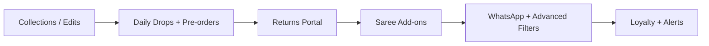

# Elaanji — Feature Gap Report & Advanced Upgrade Plan

> **Date:** 2026-08-26
> **Benchmark:** [Prashanti Sarees](https://www.prashantisarees.com/) and comparable premium saree e-commerce stores
> **Purpose:** Identify features missing in Elaanji and define an advanced, more attractive implementation plan.

---

## 1. What Elaanji Already Has ✅

| Area | Status |
|---|---|
| Authentication (JWT + OTP, forgot/reset password) | ✅ Done |
| Products, variants, inventory | ✅ Done |
| Cart, wishlist | ✅ Done |
| Checkout, addresses, orders | ✅ Done |
| Payments (Razorpay + COD) | ✅ Done |
| Coupons, reviews, banners | ✅ Done |
| Admin panel (products, orders, refunds, customers, coupons, content, reports, settings) | ✅ Done |
| Activity logs, rate limiting, SEO basics | ✅ Done |

---

## 2. What the Benchmark Does Well (Prashanti Sarees)

1. **Hero banner for premium sub-brand** ("Lila by Prashanti") — luxury storytelling
2. **"Today's New Arrivals"** — daily drops with time slots (7:00 AM, 10:45 AM, 1:45 PM, 5:00 PM) creating freshness & urgency
3. **"What are you shopping for today?"** — visual category tiles (Kanchipurams, Banarasis, Silk Cottons, Cottons…)
4. **Curated "stores within a store"** — Heritage Looms, Vadhanam (Banaras), LILA (luxury), Silk Cottons
5. **Exclusive curations/edits** — festival edits (Niraa – Deepavali 2025), numbered editions (Swara Edition 1/2/3)
6. **Bridal collections with design counts** — "Bridal Tales — 340+ DESIGNS"
7. **Celebrity/influencer wardrobe** — "Brindha's Wardrobe"
8. **Pre-order badges** on select products
9. **Physical store locator** — 6 stores with Google ratings, directions, call buttons
10. **Self-serve returns portal** — "Initiate or track your return"
11. **Product codes on every item** (BVG3868, LI0188) — enables WhatsApp/phone ordering
12. **Accessibility mode toggle**, detailed shipping/returns policy pages

---

## 3. Missing Features — Advanced Implementation Plan

### 🔴 Tier 1 — Revenue-Critical (build first)

| # | Feature | Benchmark | Elaanji Advanced Version |
|---|---|---|---|
| 1 | **Curated Collections / Edits** | Festival edits, numbered editions | `collections` module: admin-curated product groups with hero image, story, curator, schedule. Auto "340+ Designs" count badge. Seasonal auto-publish/expiry |
| 2 | **Daily Drops / New Arrivals** | "Today's New Arrivals" with time slots | `drop_at` timestamp on products → homepage "Dropping at 5:00 PM" live countdown, "Just Dropped" section, notify-me on upcoming drops |
| 3 | **Pre-orders** | Pre-order badge on select sarees | `is_preorder` + `expected_ship_date` on variants, mixed-cart handling, partial payment option, auto-notify on stock arrival |
| 4 | **Self-serve Returns Portal** | "Initiate or track your return" | Customer-facing return flow: select order item → reason → photo upload → pickup scheduling → live status tracking (extends existing `admin_refund` backend) |
| 5 | **Saree Services Add-ons** | Fall/pico, blouse stitching (industry standard) | Order line-item add-ons: Fall & Pico ₹50, blouse stitching with measurement form, petticoat add-on — priced options at PDP/checkout |

### 🟠 Tier 2 — Conversion & Engagement

| # | Feature | Elaanji Advanced Version |
|---|---|---|
| 6 | **Shop-by-fabric/occasion tiles** | "What are you shopping for today?" — visual mega-menu + homepage tiles (Kanchipuram, Banarasi, Cotton, Bridal, Office-wear) driven by category attributes |
| 7 | **Sub-brand / Curator pages** | "Brindha's Wardrobe"-style influencer/celebrity closets — collection + curator profile + story |
| 8 | **WhatsApp Commerce** | Order-by-SKU button on PDP ("Order BVG3868 on WhatsApp"), cart share, order status via WhatsApp (Meta Business API) |
| 9 | **Product code prominence** | SKU shown boldly on PDP/cards for phone/WhatsApp orders |
| 10 | **Advanced filters** | Filter by fabric, weave, zari type, border style, color family (swatch picker), occasion, price slider — attribute-based faceting |
| 11 | **Store locator** | Stores page with map, Google rating, directions, call — manageable from admin settings |
| 12 | **Recently viewed + "Complete the look"** | Cross-sell: matching blouse, petticoat, jewelry recommendations on PDP |

### 🟡 Tier 3 — Delight & Retention

| # | Feature | Elaanji Advanced Version |
|---|---|---|
| 13 | **Loyalty / rewards program** | Points per ₹ spent, referral bonuses, tier badges (Silver/Gold/Bridal Club) |
| 14 | **Live commerce / video shopping** | Scheduled live sessions, book-a-video-call with stylist |
| 15 | **Virtual drape / AR try-on** | Photo upload → saree drape preview (AI) |
| 16 | **Gift cards + gift wrap** | Digital gift cards, festive gift-wrap option with message at checkout |
| 17 | **Back-in-stock & price-drop alerts** | Wishlist-triggered email/WhatsApp notifications |
| 18 | **Accessibility mode** | One-toggle high-contrast/large-font mode |
| 19 | **Lookbook / blog (SEO)** | "Saree draping guides", fabric care — feeds existing `seo.py` |
| 20 | **Multi-currency + international shipping** | Currency switcher, duties estimate for NRI customers |

---

## 4. Suggested Build Order

**Recommended Sprint 1:** Collections module + Daily Drops + Pre-orders.
These three share data-model patterns (product grouping + scheduling) and deliver the biggest homepage transformation — making Elaanji look like a premium, daily-fresh saree destination rather than a static catalog.

---

## 5. Technical Notes

- **Collections module** → new `collections` + `collection_products` tables, admin CRUD, storefront homepage sections
- **Daily drops** → add `drop_at` (nullable timestamp) to `products`; homepage query `WHERE drop_at <= now() ORDER BY drop_at DESC`
- **Pre-orders** → add `is_preorder` (bool) + `expected_ship_date` (date) to `product_variants`; checkout validation for mixed carts
- **Returns portal** → new customer endpoints under `/api/returns` reusing `admin_refund_service` logic
- **Add-ons** → new `order_item_addons` table; PDP checkbox options; price merged into order totals
- **WhatsApp** → deep links (`wa.me`) for MVP; Meta Business API for notifications later
