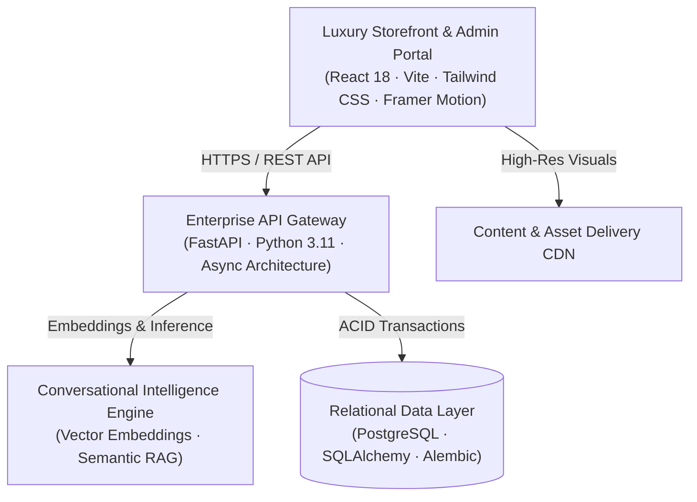

# Elaanji — Haute Couture & Luxury Handloom E-Commerce Platform

**An opulent digital flagship for timeless Indian craftsmanship and luxury handloom sarees.**

---

## ✦ Executive Overview

**Elaanji** is an enterprise-grade, omnichannel luxury e-commerce ecosystem meticulously engineered for modern connoisseurs of Indian ethnic couture. Blending centuries of artisanal heritage—including authentic *Kanjeevaram*, *Banarasi*, *Chanderi*, *Tussar*, and *Organza* weaves—with cutting-edge web architecture, Elaanji delivers a boutique shopping experience that rivals elite physical ateliers.

Crafted by **Epocx Innovations**, this platform elevates traditional textile commerce into an immersive, intelligent digital journey.

---

## ✦ Signature Platform Highlights

### 1. Cinematic Storefront Experience
- **Frame-Accurate Curtain Reveal**: A theatrical, motion-crafted curtain intro that sets an ambiance of luxury upon arrival.
- **Spotlight Hover Aesthetics**: Cursor-tracking luminance and micro-interactions tailored for high-end retail presentation.
- **Dynamic Collection Spotlights**: Curated editorial lookbooks, seasonal drops, and master weaver highlights.

### 2. Intelligent Artisan Commerce
- **Multifaceted Color & Variant Matrix**: Dynamic swatch-driven selection with variant-specific image galleries and live inventory counters.
- **AI-Powered Personal Shopping Stylist**: Natural language conversational assistant utilizing semantic vector embeddings to understand drape preferences, occasion pairing, and weave histories.
- **Curated Filtering & Discovery**: Granular attribute filtering across weave styles, fabric weight, zaree purity, and heritage origins.

### 3. Customer-Centric Retailing
- **Seamless Checkout & Payments**: Multi-stage streamlined checkout supporting cards, UPI, net banking, and COD with automated tax and shipping calculations.
- **Personalized Member Suite**: Saved luxury wishlists, address books, real-time order tracking, and order history.
- **Promotions & Privileges**: Tiered promotional coupon engine, private VIP offers, and festive announcements.

### 4. Enterprise Administrative Ecosystem
- **Omnichannel Operations Hub**: Unified management of inventory matrices, SKU variations, order fulfillment workflows, and return authorizations.
- **Dynamic Merchandising**: Visual category trees, hero banner management, and promotional flash event scheduling.
- **Actionable Business Intelligence**: Comprehensive sales analytics, conversion metrics, customer acquisition trends, and inventory health reports.

---

## ✦ Technology Architecture

The Elaanji platform is built on modern, cloud-native principles designed for extreme responsiveness, fault tolerance, and security:

- **Frontend Core**: React 18, Vite, Tailwind CSS, Framer Motion, Lucide Icons
- **Backend Core**: FastAPI (Asynchronous Python), SQLAlchemy ORM, Pydantic v2
- **Data Persistence**: PostgreSQL with full ACID transaction guarantees and automated Alembic schema evolution
- **Security & Identity**: Stateless JWT authentication, PBKDF2 cryptographic password hashing, role-based access control (RBAC), and strict CORS boundary enforcement
- **AI Concierge**: Semantic vector retrieval paired with large language model generation for contextual product recommendations

---

## ✦ Security & Compliance

Elaanji adheres to rigorous security and data protection standards:
- **Role-Based Access Control (RBAC)**: Strict segregation between customer, staff, and administrative privileges.
- **Data Encryption**: All data in transit is protected via TLS 1.3 encryption.
- **Safe State Management**: Sanitized input validation and parameterized database interactions preventing injection and XSS vectors.
- **Audit Trails**: Detailed operational and order lifecycle audit logs.

---

## ✦ Confidentiality & Intellectual Property

> [!IMPORTANT]
> **Proprietary Software Notice**
> 
> This codebase, including all design assets, component architectures, algorithms, and business logic, is the exclusive proprietary property of **Epocx Innovations** and **Elaanji**.
> 
> Unauthorized copying, cloning, reverse engineering, redistribution, or deployment of any portion of this system without explicit written authorization is strictly prohibited.

---

&copy; 2026 **Elaanji** & **Epocx Innovations**. All Rights Reserved.

